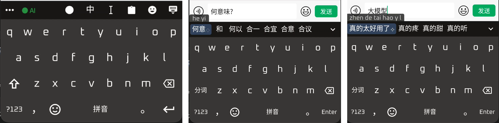

<h1 align="center">雾凇拼音 · 1zumiii Edition</h1>

<p align="center">
  基于 <a href="https://github.com/iDvel/rime-ice">雾凇拼音（rime-ice）</a> 的个人定制版本，增加最近使用优先、本地小模型 AI 重排、语法模型和模糊音，并提供鼠须管（macOS）、小狼毫（Windows）和同文输入法 Trime（Android）的配置。<br>
  上游原版的说明见 <a href="README.upstream.md">README.upstream.md</a>。
</p>

<p align="center">
  <br>
  <sub>Android（Trime）预览：GBoard 风格布局；工具栏的 <code>● AI</code> 为 AI 重排的状态和开关；候选后的 <code>◇</code> 表示该首选经上文重排得出。</sub>
</p>

---

## 项目说明

本仓库基于 [iDvel/rime-ice](https://github.com/iDvel/rime-ice) 的 `da1fbe6`（2026-10-05），在日常使用中加入了若干个人所需的功能。

主要在 macOS 鼠须管（Squirrel 1.1.2，librime 1.16）上使用和测试。Windows 小狼毫提供了一套配置，验证较少。Android 的 Trime 在一台手机（ASUS Zenfone 10）上日常使用，详见下文。

- 默认分支为 `custom`，仅从上游合并更新，不向上游推送，也不提交 PR。`main` 与上游保持一致，仅用于同步。
- 全部个人改动均放在独立文件中（`*.custom.yaml` 补丁、独立的 Lua 脚本），未直接修改上游的方案、词库和 Lua，合并上游更新时基本不会冲突。
- 仅供个人使用，未做成通用发行版。AI 重排为实验功能，只在少量用例上测试过。

## 新增功能

### 最近使用优先

最近 72 小时内上屏过的词会被提升到第 2 个候选位置（最多 2 个词），置顶词仍在最前。参数位于 `rime_ice.custom.yaml` 的 `recent_boost_filter`（`window_hours`、`idx`、`max_boost` 等）。

- 记录保存在 `~/Library/Rime/recent_words.tsv`，**内容为上屏词的明文记录**（默认最多 3000 条），不会同步，也不会进入仓库。
- 原有的词频学习（userdb）保持不变，本功能是在其基础上的补充。

### 个人词对与纠错记忆

记录“前一个词→当前词”的使用次数，同样的搭配再次出现时优先。例如经常在“明天”之后选“天气”，则上屏“明天”后输入 `tianqi`，“天气”会排在前面。计数带时间衰减（14 天衰减到约 1/e），也参与 AI 重排的融合打分（`llm_rerank/pair_gamma`，默认 1.5，设为 0 关闭）。

- 记录保存在 `~/Library/Rime/recent_pairs.tsv`，**内容为相邻上屏词的明文记录**（最多 6000 条、保留 90 天），不会同步，也不会进入仓库。删除该文件并重新部署即可清空。
- 只记含中文的词，英文和数字串不记；超过 8 个字的整句不记。
- “前一个词”仅在上一次上屏后 20 秒内有效；退格、方向键、回车之后失效。
- 纠错记忆：在“前一个词加输入的拼音”这个具体情境下记住你选了哪个词，选了非首位的权重更大；同样的情境再出现，你选过的词会优先（`llm_rerank/corr_gamma`，默认 3.0，0 关闭）。
- 开关：`recent_boost_filter/pairs`（默认 true）。提升阈值为 `min_pair`（默认 1.5，约需同一搭配重复出现两次，避免单次误选被固化）。

### 本机记录一览

下列文件都在用户目录（Mac 为 `~/Library/Rime`，手机为 Trime 的 `files/rime`），明文，只在本机，不会同步，也不会进入仓库。

| 文件 | 记什么 | 何时记 | 保留策略 |
|---|---|---|---|
| `recent_words.tsv` | 上屏的词：时间戳加词 | 每次上屏词组、用户词或整句（不记英文、数字、标点、emoji、计算器结果） | 活动文件保留最近 3000 条；更早的移到 `recent_words.archive.tsv` |
| `recent_pairs.tsv` | 相邻两个上屏词：时间戳、前一个词、当前词 | 上一个词在 20 秒内，且两个词都含中文、不超过 8 个字 | 活动文件保留 90 天内、最多 6000 条；其余移到 `recent_pairs.archive.tsv` |
| `recent_choices.tsv` | 纠错记忆：时间戳、前一个词、输入的拼音、所选词、权重 | 每次选词（选了非首位的权重 2.0，选了首位的 0.5），前一个词在 20 秒内、输入为小写拼音、所选词含中文且不超过 8 个字 | 180 天内最多 4000 条，其余进归档 |
| `select_stats.tsv` | 纯数字的选词位次（见下节） | 仅当存在 `select_stats.enabled` | 超过 2 MB 改名为 `.old`，只保留一份 |
| `select_corpus.tsv` | 训练样本（明文）：上文最后 6 个字、所选词、最终与原顺序的首位、类型 | 仅当存在 `select_corpus.enabled`；所选不是首位的全记，选了首位的随机抽 10% | 超过 2 MB 分卷并压缩，不丢弃 |

归档文件超过 512 KB 时，改名为带时间的分卷并尽力用 gzip 压缩（Windows 上没有 gzip，保留明文分卷）。归档写入成功后才会从活动文件里删除旧记录，不会因为写失败而丢失。删除对应文件即可清空。

### 置信度门控

默认关闭（`llm_rerank/gate_margin: 0`）。开启后，模型选出的首位必须比 Rime 原首位的融合分高出至少这个值才会换位，否则保持 Rime 原顺序，减少“帮倒忙”；输入只有 1 到 2 个字母时用更高的门槛（`gate_margin_short`）；有纠错记忆命中的候选不受限制。手机端默认开启（0.5 和 1.5，初值是估计）。选词统计会记录每次的 margin、是否被门控和模型首位的原位次，`tools/select_stats_report.py` 据此给出分桶校准表，用来调整门槛。

### 隐私与个人化的约定

本仓库不包含任何个人语料或个人权重，也不会发布用个人数据训练的模型。个人化微调的方法见 [docs/personalization.md](docs/personalization.md)，可在自己的设备上复现；微调出的权重只应留在本机。

### 选词统计（可选，默认关闭）

用自己的真实输入评估重排有没有帮助。每次选词记一行纯数字到 `select_stats.tsv`：时间戳、AI 开关、模型、输入字母数、参与重排的候选数、所选候选在原顺序和最终顺序里的位次、上文长度档、候选字数、候选类型。不含任何输入的文字、拼音和候选文字。

- 开启：在用户目录（Mac 为 `~/Library/Rime`，手机为 Trime 的 `files/rime`）新建空文件 `select_stats.enabled`，新开的输入会话生效。删除该文件即停止，删除 `select_stats.tsv` 即清空。数据只在本机，不会同步，也不会进入仓库。
- 汇总：`python3 tools/select_stats_report.py select_stats.tsv`，给出原顺序第一位被选中的比例与重排后的比例、重排救回与帮倒忙的次数，并按模型、输入长度、上文长度分组。

### AI 重排（实验，macOS Apple Silicon；Android 见下一节）

使用本地小模型（Qwen3.5-0.8B，Q4_K_M 量化），依据本次输入会话中刚上屏的内容对候选词重新排序。例如上屏“我最近没有太多”后输入 `jingli`，首选由“经理”变为“精力”。输入 `jingliguolai` 时，两阶段重排可得到“经理过来”。

- 移植自 [zhanghaozhecn/rime-llm-rerank](https://github.com/zhanghaozhecn/rime-llm-rerank)（署名许可，原版仅支持 Windows）。C++ 推理核心未改动，移除了 Windows 的光标上文读取；Lua 层按雾凇拼音的候选结构和 Squirrel 重写了一部分，详见 [llm-mac/README.md](llm-mac/README.md)。
- 标记：重排后的首选候选带 `◇`，四字两阶段得出的首选带 `◈`。
- 开关：默认开启，按输入框独立生效（鼠须管的每个输入框为独立会话）。`Control+Shift+5` 可在当前输入框临时开关。需要默认关闭时，将 `rime_ice.custom.yaml` 中 `ai_rerank` 开关的 `reset` 改为 `0`。
- 上文仅取自 Rime 的 `commit_history`，即本次会话中经输入法上屏的内容，不读取任何应用内的文字，因此切换输入框后的第一个词不会重排。
- 隐私：AI 重排本身不写入任何包含输入内容的文件，不联网（最近使用与个人词对的记录见上文，二者均为本机文件）。上游原有的训练语料、事件日志和词频落盘均已删除。
- 不阻塞输入：打分不等待后台预解码。上文尚未预解码完成时，当次按键保持原顺序，下一次按键再重排。输入串变短（退格修改）时不执行耗时的第二阶段。第一阶段结果按“上文 + 候选”缓存，输入同一个词的各个字母时不重复推理。
- 触发范围：默认仅对 3 个字母及以上的输入触发（`code_pattern: [a-z]{3,}`），避开置顶词和简拼。仅在前 80 个候选内重排，其余候选保持惰性生成，以避免雾凇大词库造成卡顿。
- 空闲自动卸载：20 分钟无输入即释放模型（回收约 320 MB 内存），下次输入时自动重新加载（约 1 秒，期间不重排）。连续输入时该机制不会触发。将 `idle_unload_minutes` 设为 0 可关闭。
- 可选 Metal GPU 推理：构建时加 `-DRIME_LLM_METAL=ON`。实测单次打分由约 27 ms 降至约 13 ms，CPU 时间减少约 97%，内存增加约 45 MB，详见 [llm-mac/README.md](llm-mac/README.md)。
- 资源占用（Apple Silicon，CPU 推理，4 线程）：模型加载约 1 秒，单次打分约 27 ms，Squirrel 内存占用约 394 MB。已关闭 llama.cpp 的权重重排（`use_extra_bufts = false`），内存由 869 MB 降至 374 MB，单次打分约慢 7 ms。
- 局限：仅用十余条同音词用例验证，不代表真实输入的准确率。该功能只重排 Rime 已生成的候选，不会产生新候选。

需自行编译 `rime_llm.so`（Xcode、CMake）并下载约 508 MB 的模型，步骤见 [llm-mac/README.md](llm-mac/README.md)。
- 后续：通用的几亿参数模型在手机等设备上延迟和内存偏高。目前正在测试并训练输入法专用的小模型来解决这些痛点，已有初步结果，后续可能公开。

### Android（同文输入法 Trime）

同一套配置和 AI 重排也适用于手机端。推理运行在独立的常驻进程中，Trime 内仅保留一个轻量客户端，因此输入法进程被终止或崩溃时，模型不会随之丢失。设计、实测数据和文件清单见 [llm-android/README.md](llm-android/README.md)。

- 改版 Trime：在上游固定提交上应用[一个补丁](llm-android/trime/patches/0001-ai-rerank-daemon.patch)，新增 `INTERNET` 权限（仅连接本机 127.0.0.1）、亮灭屏通知、工具栏 `● AI` 状态徽标，以及经 Shizuku 启动守护进程的入口。**仓库不含 APK**，须自行编译，并使用自己的密钥签名（`llm-android/trime/build_apk.sh`）。
- 常驻推理进程 `rimellmd`：独立二进制，由 adb 或 Shizuku 以 shell 身份启动。监督进程负责看护工作进程，工作进程被终止、崩溃或无响应时，按退避时间自动重启并记录原因。与 Trime 之间通过 127.0.0.1 通信，使用随机令牌认证。所有 I/O 均有时限，无法连接时当次不重排，输入不受影响。推理引擎与 Mac 端为同一份。
- 手动启停：点按工具栏的 `● AI` 徽标即可开关 AI。绿色为在线，黄色为加载或重启中，灰色为已关闭，红色为离线（点按后经 Shizuku 启动）。长按可查看内存、延迟、重启次数和上次退出原因。关闭时立即卸载模型，进程仅保持待命；开启时立即加载。不自动卸载，新安装默认关闭，用户的选择会被保留。
- 孤儿保护：Trime 被卸载后，其数据目录随之消失。守护进程检测到该目录连续 10 分钟不存在时自行退出，监督进程随之结束，避免模型无人管理而持续占用内存。重新安装 Trime 后，点按红色徽标即可再次启动。
- 配置更新：左侧三个点打开的面板里的“从仓库更新”进入更新界面，从指定的 GitHub 仓库下载最新配置并覆盖到输入法，推送后无需连接电脑。仓库地址和分支可修改，fork 本仓库的用户填入自己的地址即可。覆盖前自动备份上一个版本（只保留一份），更新后连续崩溃两次会自动回退；也可手动回退。词频、用户词、最近使用记录、语法模型和推理模型不会被改动。
- 学生模型（测试中）：用 Qwen 作教师蒸馏出的约 16.5M 参数的输入法专用排序模型，评测准确率接近 Qwen3.5-0.8B，手机上打分延迟约 12 ms（0.8B 约 60~80 ms）。目前仅在安卓端试用：把 `student.gguf` 和 `student.vocab.txt` 放进 Trime 用户目录后重启守护进程即启用，删除即回到 0.8B。模型尚未公开发布，详见 [llm-android/README.md](llm-android/README.md)。
- 手机端调优（骁龙 8 Gen 2 实测）：2 个推理线程（4 个线程会因忙等出现偶发的数秒卡顿）、3 个候选（比 5 个快约三分之一）、上文 6 个 token，关闭四字词的第二阶段。这些设置仅写在 `llm-android/trime/*.overlay.yaml` 中，部署时才追加，不影响 Mac 和 Windows。
- GBoard 风格布局：同文风主题改为 GBoard 的主页面和 `?123` 数字符号页，符号页每页 4 行 × 7 列，按键使用线条图标。空格键在中文模式下显示“拼音”，英文模式下显示“English”。补丁由 [gen_tongwenfeng_patch.py](llm-android/trime/gen_tongwenfeng_patch.py) 依据主题源文件生成。
- 适用范围：仅在这一台手机上验证过，其他机型和 Trime 版本未测试。手机重启后，须先启动 Shizuku，才能启动守护进程。

### 语法模型

已配置万象语法模型 `wanxiang-lts-zh-hans.gram`（约 379 MB），用于改善整句输入时的同音字选择。Squirrel 自带 octagram 插件。模型文件不在仓库中，须自行从 [amzxyz/RIME-LMDG](https://github.com/amzxyz/RIME-LMDG/releases) 下载，放入 `~/Library/Rime/`。缺少该文件时，相关配置会被忽略，不影响使用。

整句候选带 `❖` 标记（`model_badge_filter.lua`）。

### 模糊音

已开启平翘舌（z/zh、c/ch、s/sh）和前后鼻音（an/ang、en/eng、in/ing）。规则位于 `algebra_extra.yaml`，由 `tools/gen_typo_rules.py` 生成。需要关闭某一组时，在脚本中注释对应行并重新生成。

脚本中另有“相邻按键误触容错”，默认关闭。实测它会误吞“完整拼音夹带缩写”的输入，因此不启用。

### 其他小改动

| 改动 | 说明 |
| --- | --- |
| 冷词降频 | 启用上游自带的 `cold_word_drop`：`Control+j` 降频，`Control+x` 隐藏，`Control+d` 强制删词 |
| 英文、自定义短语调频 | `melt_eng` 打开用户词典，`custom_phrase` 改为 `tabledb`（Rime 会回写 `custom_phrase.txt`） |
| 中英混输自动空格 | 启用上游自带的 `cn_en_spacer`，`VIP中P` → `VIP 中 P` |
| 每页候选 5 个 | 7 个时短词容易折到第二行 |
| 方案列表 | 仅保留 `rime_ice`（全拼）。九宫格和各种双拼方案文件已从本仓库删除，需要时从上游取回，并在 `default.custom.yaml` 的 `schema_list` 中添加 |
| 外观 | `squirrel.custom.yaml`：微信键盘配色、横排候选、OpenSans 字体 |

## 注意事项

修改补丁时需注意以下各项，均为实际遇到的问题：

1. 不要用 `__patch` 引用带 `/+` 的文件。这样 `/+` 不会按“追加”处理，而会整段替换官方的 `speller/algebra`，导致所有简拼（`zm`、`zuijd`）失效。应使用 `"speller/algebra/+": { __include: algebra_extra:/rules }`。`tools/verify_build.sh` 会在安装前检查这一点。
2. 不要用 `@last`。它表示“替换最后一项”，会挤掉官方末尾的 `uniquifier`。追加应使用 `@before last` 或 `@after last`。
3. 补丁键按字典序依次生效，带数字的 `@before N` 依赖前面的插入。同一个键只能写一次，因此 `@before 0`、`@after last` 这类位置各只能由一个组件使用。
4. 替换已存在的 `rime_llm.so` 须先删除再复制。原地覆盖会使 macOS 缓存的旧代码签名与新内容不符，加载时内核直接以 `SIGKILL (Code Signature Invalid)` 终止进程，输入法一启动即崩溃，反复崩溃后系统会将其从已启用的输入法中移除。`llm-mac/install_llm.sh` 已按此处理。
5. 鼠须管的开关状态按输入框独立保存，新输入框会恢复默认值，因此需要常开的开关应将默认值设为开。
6. 不要把绑定了引擎的对象缓存为 Lua 模块级变量。鼠须管的每个输入框和应用都有独立的引擎，而 Lua 模块是共享的。将 `Component.Translator(...)` 存为模块级变量后，后创建的输入框会使用已销毁引擎中的翻译器，`query` 时访问野指针，进程因段错误退出（崩溃报告中为 `ScriptTranslator::Query`）。应存放在 `env` 中，随引擎一同销毁。
7. 使用 Metal 时，退出前须先释放模型。llama.cpp 的 Metal 设备对象在进程退出的静态析构阶段断言缓冲区已全部释放，未释放则 abort，输入法每次退出都会留下崩溃报告。
8. 上游的 `.gitignore` 会忽略 `*.custom.yaml`。本仓库已放行根目录、`windows/` 和 `llm-android/trime/` 下的此类文件。
9. Trime 不可调试，数据目录又为 `noexec`，`.so` 无法从外部放入，只能打包进 APK。更换签名须先卸载原有的 Trime，这会清空其数据目录，卸载前须备份。
10. 手机端推理线程不宜设为 4 个。预解码和打分同时运行，ggml 线程池忙等，在大小核混合并与其他应用争用核心的环境下，会出现偶发的数秒卡顿。2~3 个线程没有此问题，延迟也几乎相同（该模型含按顺序处理的循环层，延迟下限与线程数无关）。
11. Trime 的主题补丁文件名须为 `<主题 id>.custom.yaml`（同文风为 `tongwenfeng.trime.custom.yaml`）。Trime 仅在输入法服务启动时读取主题，修改后须重启一次 Trime。按键自带的 `label` 仅在中文模式下生效，英文模式显示预设标签，因此图标应修改在 `preset_keys` 中。
12. 覆盖安装 Trime 后，输入法服务须等到键盘弹出才会启动，此前发出的部署广播会丢失。应先打开任意输入框，再执行部署。

## 编译与安装

### macOS（鼠须管）

```bash
git clone https://github.com/1zumiii/rime-ice-Custom.git
cd rime-ice-Custom
./install.sh            # 先自检，再备份到 ~/Library/Rime.backup-时间，然后安装（保留词频库等个人数据）
```

`install.sh` 不会覆盖：`*.userdb`（词频库）、`installation.yaml`、`user.yaml`、`recent_words.tsv`、`recent_pairs.tsv`、冷词记录和已存在的 `custom_phrase.txt`。安装后须重启输入法（`Squirrel --quit`，下次输入时由系统重新启动）。

AI 重排的二进制和模型另行安装：`llm-mac/install_llm.sh`，步骤见 [llm-mac/README.md](llm-mac/README.md)。

### Windows（小狼毫）

`windows/` 提供一套适配：

- `install.ps1`：先备份再安装，保留现有的 `default.custom.yaml` 和用户数据。
- `check_deployed.ps1`：部署后检查官方拼写规则是否被补丁覆盖。
- `rime_ice.custom.yaml`：移除了可能与 AI 重排冲突的功能。

脚本已在真实 Windows 上运行并修复了几个问题：`robocopy` 遇到被占用的文件会无限等待，预览不显示文件列表，会覆盖用户自己的 `weasel.yaml` 样式。覆盖面仍然有限，建议先用 `-DryRun` 预览。

**安装后须点击托盘图标中的“重新部署”。** 命令行的 `WeaselDeployer.exe /deploy` 不会实际编译方案。

脚本不会复制 `weasel.yaml`，因此用户自己的小狼毫样式会保留。样式覆盖应写在 `weasel.custom.yaml` 中。

Windows 上的 AI 重排使用自行从源码编译的上游插件，带有一些本地补丁，补丁不在本仓库中，并非此处的 macOS 移植。

### Android（Trime）

前提：已安装改版 Trime 并完成首次引导（选择“使用应用专属存储空间”），手机通过 adb 连接，且已安装 Shizuku。

```bash
llm-android/trime/build_apk.sh                       # 从源码编译改版 APK 并签名（首次需要 JDK 17、NDK r27d 等，见脚本开头）
adb install -r <生成的 apk>
llm-android/deploy_trime.sh --with-gram              # 推送配置和语法模型；须先让 Trime 键盘弹出，部署才会生效
llm-android/daemon/rimellmctl.sh start               # 在电脑端启动守护进程（也可在手机上点按红色 AI 徽标，经 Shizuku 启动）
```

模型文件 `Qwen3.5-0.8B-Q4_K_M.gguf` 须放入 Trime 的用户目录（`/sdcard/Android/data/com.osfans.trime/files/rime/`）。完整说明、测试和基准脚本见 [llm-android/README.md](llm-android/README.md)。

## 同步上游更新

```bash
git fetch upstream
git checkout main && git merge --ff-only upstream/main && git push origin main
git checkout custom && git merge main
```

本仓库已删除用不到的双拼和九宫格方案（`double_pinyin*.schema.yaml`、`t9.schema.yaml`）。上游修改这些文件时，合并会报“上游已修改、本仓库已删除”的冲突，直接删除即可：

```bash
git rm double_pinyin*.schema.yaml t9.schema.yaml
git commit
```

## 自定义内容的位置

| 位置 | 内容 |
| --- | --- |
| `rime_ice.custom.yaml`、`default.custom.yaml`、`squirrel.custom.yaml` | 方案、全局和外观补丁 |
| `algebra_extra.yaml`、`tools/gen_typo_rules.py` | 模糊音与（默认关闭的）邻键容错规则 |
| `lua/recent_boost_filter.lua` | 最近使用优先 |
| `lua/ai_rerank_filter.lua`、`lua/ai_rerank_processor.lua` | AI 重排的过滤器与处理器 |
| `lua/model_badge_filter.lua` | 整句候选的 `❖` 标记 |
| `llm-mac/` | AI 重排的 macOS 移植：转换脚本、构建配置、安装脚本、测试 |
| `windows/` | 小狼毫适配 |
| `llm-android/` | Android（Trime）：常驻推理进程、Trime 补丁与构建脚本、手机端专属配置、GBoard 风格布局补丁、基准与测试 |
| `install.sh`、`tools/verify_build.sh` | 安装与安装前自检 |

## 致谢与许可

感谢 [iDvel/rime-ice](https://github.com/iDvel/rime-ice) 及其贡献者；[zhanghaozhecn/rime-llm-rerank](https://github.com/zhanghaozhecn/rime-llm-rerank)（AI 重排，署名许可，个人使用无限制）；[amzxyz/RIME-LMDG](https://github.com/amzxyz/RIME-LMDG)（万象语法模型）；[llama.cpp](https://github.com/ggml-org/llama.cpp)；[osfans/trime](https://github.com/osfans/trime)（同文输入法，GPL-3.0）及同文风主题作者暖暖；[Shizuku](https://github.com/RikkaApps/Shizuku)；以及 Rime、librime-lua、librime-octagram 的作者们。

本仓库沿用上游的 GPL-3.0 许可证，见 [LICENSE](LICENSE)。模型文件和语法模型各自遵循其发布方的许可。
